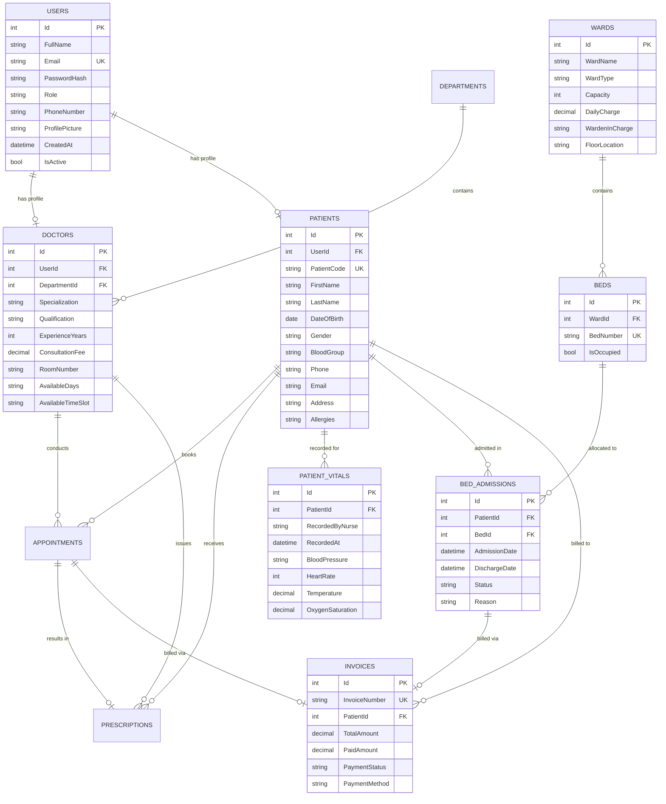

# 🏛️ Architecture & Technical Design Specification

## 1. System Overview

Medicare Hospital Management System (HMS) is structured around the **Model-View-Controller (MVC)** architectural pattern utilizing **ASP.NET Core (.NET 8/9)** and **Entity Framework Core**. It enforces separation of concerns across presentation, business logic, domain models, and persistence.

```
[ Web Browser / Client ]
         │ (HTTP / HTTPS / AJAX)
         ▼
[ ASP.NET Core Middleware Pipeline ]
   ├── Static Files (wwwroot)
   ├── Routing
   ├── Session
   ├── Cookie Authentication & Claims Evaluation
   └── Authorization Policies
         │
         ▼
[ MVC Controllers ] ───► [ Toastr Notifications & TempData ]
   ├── AccountController (Auth, Sign Up, Login, Forgot Password)
   ├── DashboardController (KPIs & Metrics)
   ├── DoctorsController (CRUD & Specialist directory)
   ├── PatientsController (CRUD & Electronic Medical Records)
   ├── AppointmentsController (Booking, Triage & AJAX status)
   ├── WardenController (Wards, Interactive Bed Matrix, Admissions)
   ├── NurseController (Vitals Monitoring & Trends)
   ├── PrescriptionsController (Rx Builder & Print view)
   └── BillingController (Invoices & Payment Processing)
         │
         ▼
[ Entity Framework Core (ApplicationDbContext) ]
         │
         ▼
[ Database Storage: SQLite / Microsoft SQL Server ]
```

---

## 2. Authentication & Authorization Security Model

### Cookie Authentication & Claims
Authentication is implemented via ASP.NET Core's Cookie Authentication handler (`CookieAuthenticationDefaults.AuthenticationScheme`). Upon successful credential verification, the system writes an encrypted HTTP-only cookie with the following claims:

- `ClaimTypes.NameIdentifier`: User ID (`int`)
- `ClaimTypes.Name`: User Full Name (`string`)
- `ClaimTypes.Email`: Registered Email Address (`string`)
- `ClaimTypes.Role`: System Role (`Admin`, `Doctor`, `Nurse`, `Warden`, `Patient`)
- `ProfilePicture`: Relative URL to the user's avatar image (displayed in the top navigation bar)

### Password Security
Passwords are never stored in plain text. They are hashed and salted using **BCrypt** with an adaptive work factor via `BCrypt.Net-Next`.

### Role-Based Access Control (RBAC) Matrix

| Module / Action | Patient | Doctor | Nurse | Warden | Admin |
| :--- | :---: | :---: | :---: | :---: | :---: |
| **View Dashboard** | Personal | Doctor-specific | Ward-specific | Ward-specific | Complete |
| **Book Appointment** | ✅ (Self) | ✅ | ✅ | ✅ | ✅ |
| **Update Appointment Status** | ❌ | ✅ | ✅ | ✅ | ✅ |
| **Create / Edit Doctors** | ❌ | ❌ (Profile only) | ❌ | ❌ | ✅ |
| **Register / Edit Patients** | ✅ (Self) | ✅ | ✅ | ✅ | ✅ |
| **Admit / Discharge Beds** | ❌ | ❌ | ❌ | ✅ | ✅ |
| **Record Patient Vitals** | ❌ | ✅ | ✅ | ❌ | ✅ |
| **Issue Prescriptions** | ❌ | ✅ | ❌ | ❌ | ✅ |
| **Process Billing & Invoices**| View own | View | View | ✅ | ✅ |
| **Manage Departments** | Read | Read | Read | Read | ✅ |

---

## 3. Database Entity-Relationship (ER) Model



---

## 4. Toastr Notification Architecture

Notifications are managed through a dual-channel pipeline:

1. **Server-to-Client Flash Messaging**:
   Controllers populate standard `TempData["SuccessMessage"]`, `TempData["ErrorMessage"]`, `TempData["InfoMessage"]`, or `TempData["WarningMessage"]`. The `_Layout.cshtml` renders a lightweight JavaScript block on DOM load that invokes Toastr immediately with preconfigured animations and auto-dismiss timeouts.

2. **Client-Side AJAX Feedback**:
   Interactive actions (e.g., updating appointment triage status, collecting invoice payments, admitting patients) trigger asynchronous jQuery AJAX requests. Upon response, `notifySuccess(msg)` or `notifyError(msg)` fires without causing a full-page reload, keeping the user in flow.

